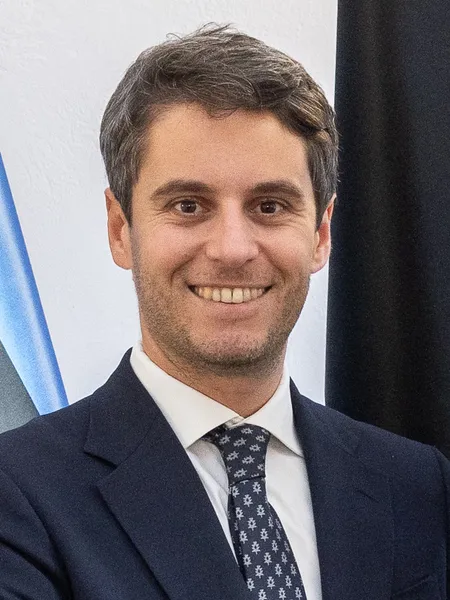

# Gabriel Attal

**Renaissance** · 38 ans au 1er tour (18 avril 2027)

Photo [Gabriel Attal in 2026 (2).jpg](https://commons.wikimedia.org/wiki/File:Gabriel_Attal_in_2026_(2).jpg) · Stenbocki maja · [CC BY 4.0](https://creativecommons.org/licenses/by/4.0) · redimensionnée.

## Dans la course

- **Statut** : Candidature annoncée le 22 mai 2026
- **Présidentielles passées** : aucune

## Aujourd’hui

Secrétaire général de Renaissance et président du groupe à l’Assemblée, depuis 2024

## Parcours

- **2024** · Premier ministre (janvier-septembre) *(nommé)*
- **2023–2024** · Ministre de l’Éducation nationale *(nommé)*
- **2020–2022** · Porte-parole du gouvernement *(nommé)*
- **2017** · Député des Hauts-de-Seine *(élu)*

## Formation et métier

- **Formation** : Sciences Po Paris
- **Métier** : Conseiller au cabinet de la ministre de la Santé (2012-2017)

## Sources

- [Wikipédia](https://fr.wikipedia.org/wiki/Gabriel_Attal)
- [LCP, 23 nov. 2026](https://lcp.fr/actualites/presidentielle-2027-la-liste-des-candidats-declares-et-potentiels-444932)
- [Assemblée nationale, notices et portraits](https://www2.assemblee-nationale.fr/static/tribun/trombinoscope/trombinoscope_groupe.pdf)

*À jour le 24 novembre 2026. Le repère sondages suit `js/data.js`.*
