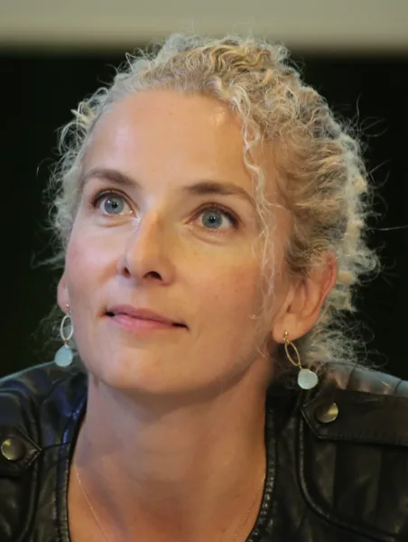

# Delphine Batho

**Génération écologie** · 54 ans au 1er tour (18 avril 2027)

Photo [Delphine Batho (cropped-2).png](https://commons.wikimedia.org/wiki/File:Delphine_Batho_(cropped-2).png) · DeuxSevres79 · [CC BY-SA 4.0](https://creativecommons.org/licenses/by-sa/4.0) · redimensionnée.

## Dans la course

- **Statut** : Candidature annoncée le 25 novembre 2025, investie par Génération écologie le 6 juin 2026
- **Présidentielles passées** : aucune
- Primaire écologiste 2021 : 3e au 1er tour (22,32 %)

## Aujourd’hui

Députée des Deux-Sèvres, présidente de Génération écologie depuis 2018

## Parcours

- **2018** · Présidente de Génération écologie *(parti)*
- **2012–2013** · Ministre de l’Écologie *(nommée)*
- **2012** · Ministre déléguée à la Justice *(nommée)*
- **2007** · Députée des Deux-Sèvres *(élue)*

## Formation et métier

- **Formation** : Baccalauréat (lycée Henri-IV, 1992)
- **Métier** : Collaboratrice d’élu au conseil régional d’Île-de-France

## Sources

- [Wikipédia](https://fr.wikipedia.org/wiki/Delphine_Batho)
- [L’Info durable (AFP)](https://www.linfodurable.fr/lex-ministre-delphine-batho-candidate-la-presidentielle-pour-conjurer-la-rikikisation-de-lecologie)

*À jour le 24 novembre 2026. Le repère sondages suit `js/data.js`.*
