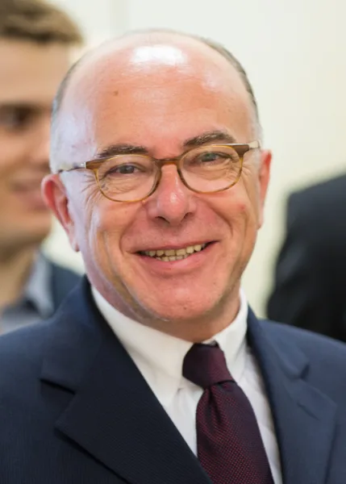

# Bernard Cazeneuve

**La Convention** · 63 ans au 1er tour (18 avril 2027)

Photo [Bernard Cazeneuve, (42399145362) (cropped).jpg](https://commons.wikimedia.org/wiki/File:Bernard_Cazeneuve,_(42399145362)_(cropped).jpg) · Jérémy Barande · [CC BY-SA 2.0](https://creativecommons.org/licenses/by-sa/2.0) · redimensionnée.

## Dans la course

- **Statut** : « Lettre aux Français » le 16 juillet 2026, refuse la primaire du PS
- **Présidentielles passées** : aucune

## Aujourd’hui

Fondateur du mouvement La Convention, avocat

## Parcours

- **2016–2017** · Premier ministre *(nommé)*
- **2014–2016** · Ministre de l’Intérieur *(nommé)*
- **2013–2014** · Ministre délégué au Budget *(nommé)*
- **2001–2012** · Maire de Cherbourg-Octeville *(élu)*

## Formation et métier

- **Formation** : Sciences Po Bordeaux
- **Métier** : Avocat

## Sources

- [Wikipédia](https://fr.wikipedia.org/wiki/Bernard_Cazeneuve)
- [LCP, 30 juil. 2026](https://lcp.fr/actualites/presidentielle-2027-l-objectif-de-bernard-cazeneuve-est-de-devenir-president-de-la)

*À jour le 24 novembre 2026. Le repère sondages suit `js/data.js`.*
