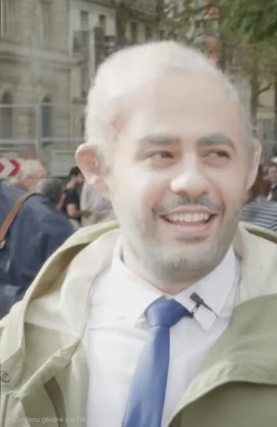

# Raphaël Glucksmann

**Place publique** · 47 ans au 1er tour (18 avril 2027)

Photo [Portrait officiel de Raphaël Glucksmann, juillet 2024](https://commons.wikimedia.org/wiki/File:1720448398743_20240708_GLUCKSMANN_Raphael_FR_006.jpg) · © Union européenne 2024, Parlement européen · [Conditions de réutilisation du Parlement européen](https://www.europarl.europa.eu/legal-notice/true) · redimensionnée.

## Dans la course

- **Statut** : Candidature annoncée le 23 août 2026, vainqueur de la primaire PS-Place publique en octobre. Son équipe vise 2 500 parrainages, selon Le Monde du 27 novembre 2026.
- **Présidentielles passées** : aucune

## Aujourd’hui

Cofondateur de Place publique et député européen depuis 2019, il siège au groupe des Socialistes et Démocrates (S&D).

## Parcours

- **2024** · Réélu député européen, liste PS-Place publique *(élu)*
- **2019** · Député européen *(élu)*
- **2018** · Cofondateur de Place publique *(parti)*
- **2009–2012** · Conseiller du président de la Géorgie *(nommé)*

## Formation et métier

- **Formation** : Sciences Po Paris
- **Métier** : Documentariste et essayiste

## Sources

- [Parlement européen](https://www.europarl.europa.eu/meps/fr/197694/RAPHAEL_GLUCKSMANN/home)
- [Wikipédia](https://fr.wikipedia.org/wiki/Rapha%C3%ABl_Glucksmann)
- [LCP, 23 nov. 2026](https://lcp.fr/actualites/presidentielle-2027-la-liste-des-candidats-declares-et-potentiels-444932)
- [Le Monde, 27 nov. 2026](https://www.lemonde.fr/politique/article/2026/11/27/presidentielle-2027-raphael-glucksmann-cherche-a-tisser-un-reseau-d-elus-locaux_6815814_823448.html)

*À jour le 27 novembre 2026. Le repère sondages suit `js/data.js`.*
