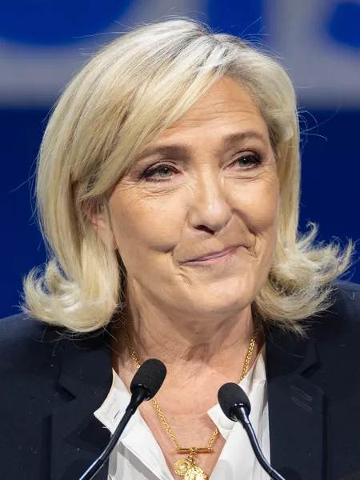

# Marine Le Pen

**Rassemblement national** · 58 ans au 1er tour (18 avril 2027)

Photo [Marine Le Pen 2025 (cropped).jpg](https://commons.wikimedia.org/wiki/File:Marine_Le_Pen_2025_(cropped).jpg) · Vox España · [CC0](https://creativecommons.org/publicdomain/zero/1.0/deed.en) · redimensionnée.

## Dans la course

- **Statut** : Candidate déclarée le 7 juillet 2026, jour de l’arrêt d’appel qui la laisse éligible ; pourvoi en cassation en attente
- **Présidentielles passées** : 2012 : 17,90 % · 2017 : 21,30 %, 2nd tour : 33,90 % · 2022 : 23,15 %, 2nd tour : 41,45 %

## Aujourd’hui

Présidente du groupe RN à l’Assemblée depuis 2022, députée du Pas-de-Calais depuis 2017

## Parcours

- **2017** · Députée du Pas-de-Calais *(élue)*
- **2011–2021** · Présidente du FN, devenu RN *(parti)*
- **2004–2017** · Députée européenne *(élue)*
- **1998–2021** · Conseillère régionale *(élue)*

## Formation et métier

- **Formation** : DEA de droit pénal (université Paris II)
- **Métier** : Avocate (1992-1998)

## Sources

- [Wikipédia](https://fr.wikipedia.org/wiki/Marine_Le_Pen)
- [LCP, 7 juil. 2026](https://lcp.fr/actualites/ce-soir-je-suis-candidate-a-l-election-presidentielle-annonce-marine-le-pen-438886)

*À jour le 24 novembre 2026. Le repère sondages suit `js/data.js`.*
