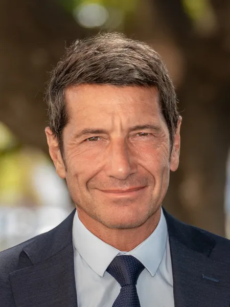

# David Lisnard

**Nouvelle Énergie** · 58 ans au 1er tour (18 avril 2027)

Photo [David Lisnard en 2026.jpg](https://commons.wikimedia.org/wiki/File:David_Lisnard_en_2026.jpg) · Grégor Sauvagère · [CC BY-SA 4.0](https://creativecommons.org/licenses/by-sa/4.0) · redimensionnée.

## Dans la course

- **Statut** : Candidature annoncée en janvier 2025
- **Présidentielles passées** : aucune

## Aujourd’hui

Maire de Cannes depuis 2014, réélu en 2026, président de l’Association des maires de France

## Parcours

- **2021** · Président de l’Association des maires de France *(élu)*
- **2017** · Président de l’agglomération Cannes Pays de Lérins *(élu)*
- **2014** · Maire de Cannes *(élu)*
- **2001** · Conseiller municipal de Cannes *(élu)*

## Formation et métier

- **Formation** : Sciences Po Bordeaux (1992)
- **Métier** : Chef d’entreprise (magasins de vêtements pour enfants)

## Sources

- [Wikipédia](https://fr.wikipedia.org/wiki/David_Lisnard)
- [France-Vote](https://www.france-vote.fr/candidats)

*À jour le 24 novembre 2026. Le repère sondages suit `js/data.js`.*
