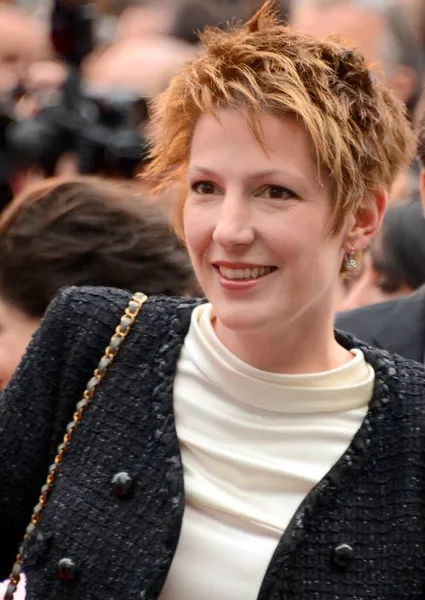

# Natacha Polony

**Nous sommes la France** · 52 ans au 1er tour (18 avril 2027)

Photo [Natacha Polony Cannes 2015.jpg](https://commons.wikimedia.org/wiki/File:Natacha_Polony_Cannes_2015.jpg) · Georges Biard · [CC BY-SA 3.0](https://creativecommons.org/licenses/by-sa/3.0) · redimensionnée.

## Dans la course

- **Statut** : Candidature annoncée le 14 octobre 2026
- **Présidentielles passées** : aucune
- **Promesses de parrainage** : Sur BFMTV le 24 novembre 2026, Natacha Polony dit avoir recueilli environ la moitié des 500 promesses recherchées. Le Conseil constitutionnel validera les parrainages après l’ouverture du recueil officiel.

## Aujourd’hui

Présidente du mouvement Nous sommes la France (2026)

## Parcours

- **2018–2025** · Directrice de la rédaction de Marianne *(carrière)*
- **2011–2014** · Chroniqueuse à « On n’est pas couché » (France 2) *(carrière)*
- **2002** · Candidate aux législatives à Paris (Pôle républicain) *(candidature)*
- **2001** · Secrétaire nationale du Mouvement des citoyens *(parti)*

## Formation et métier

- **Formation** : Agrégation de lettres modernes (1999), Sciences Po
- **Métier** : Journaliste et essayiste, ancienne professeure de lettres

## Sources

- [Wikipédia](https://fr.wikipedia.org/wiki/Natacha_Polony)
- [LCP, 14 oct. 2026](https://lcp.fr/actualites/natacha-polony-annonce-sa-candidature-a-l-election-presidentielle-443808)
- [LCP, 25 nov. 2026](https://lcp.fr/actualites/presidentielle-2027-ou-en-sont-les-candidats-dans-leur-recolte-des-500-parrainages)

*À jour le 26 novembre 2026. Le repère sondages suit `js/data.js`.*
