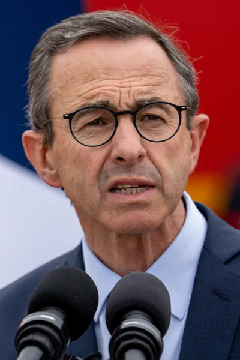

# Bruno Retailleau

**Les Républicains** · 66 ans au 1er tour (18 avril 2027)

Photo [Bruno Retailleau - Ministre de l'Intérieur français (cropped).jpg](https://commons.wikimedia.org/wiki/File:Bruno_Retailleau_-_Ministre_de_l%27Int%C3%A9rieur_fran%C3%A7ais_(cropped).jpg) · Anthonymontardyfr · [CC BY 4.0](https://creativecommons.org/licenses/by/4.0) · redimensionnée.

## Dans la course

- **Statut** : Candidature annoncée le 12 février 2026
- **Présidentielles passées** : aucune

## Aujourd’hui

Président des Républicains depuis mai 2025, sénateur de la Vendée

## Parcours

- **2025** · Président des Républicains *(parti)*
- **2024–2025** · Ministre de l’Intérieur *(nommé)*
- **2010–2015** · Président du conseil général de la Vendée *(élu)*
- **2004** · Sénateur de la Vendée *(élu)*

## Formation et métier

- **Formation** : Sciences Po Paris (1985)
- **Métier** : Dirigeant d’une radio locale, puis d’une école de communication

## Sources

- [Wikipédia](https://fr.wikipedia.org/wiki/Bruno_Retailleau)
- [Public Sénat](https://www.publicsenat.fr/actualites/politique/https-www-publicsenat-fr-actualites-politique-je-serai-le-president-de-lordre-de-la-justice-et-de-la-fierte-francaise-bruno-retailleau-se-declare-candidat-a-la-presidentielle-de-2027)

*À jour le 24 novembre 2026. Le repère sondages suit `js/data.js`.*
