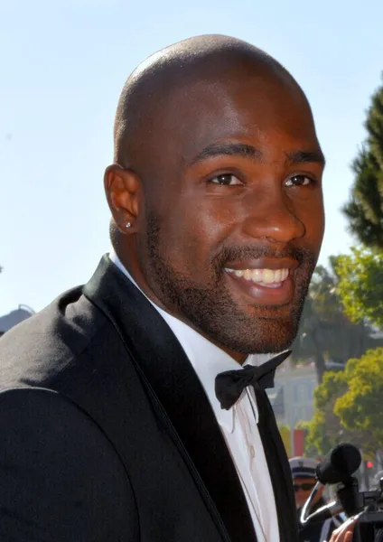

# Teddy Riner

**Sans étiquette** · 38 ans au 1er tour (18 avril 2027)

Photo [Teddy Riner Cannes 2016.jpg](https://commons.wikimedia.org/wiki/File:Teddy_Riner_Cannes_2016.jpg) · Georges Biard · [CC BY-SA 3.0](https://creativecommons.org/licenses/by-sa/3.0) · redimensionnée.

## Dans la course

- **Statut** : Candidature annoncée le 9 novembre 2026
- **Présidentielles passées** : aucune
- **Promesses de parrainage** : Au Congrès des maires le 25 novembre 2026, Teddy Riner annonce avoir dépassé 100 promesses. Le Conseil constitutionnel validera les parrainages après l’ouverture du recueil officiel.

## Aujourd’hui

Judoka, ambassadeur de l’Unicef depuis 2018

## Parcours

- **2024** · Champion olympique, en individuel et par équipes (Paris) *(sport)*
- **2016** · Champion olympique (Rio) *(sport)*
- **2013** · Président de la commission des athlètes de la Fédération internationale *(élu)*
- **2012** · Champion olympique (Londres) *(sport)*

## Formation et métier

- **Formation** : Bac pro (2009), certificat Sciences Po pour sportifs de haut niveau
- **Métier** : Judoka : 5 titres olympiques, 11 titres mondiaux en individuel

## Sources

- [Wikipédia](https://fr.wikipedia.org/wiki/Teddy_Riner)
- [LCP, 9 nov. 2026](https://lcp.fr/actualites/le-judoka-teddy-riner-annonce-sa-candidature-a-l-election-presidentielle-de-2027-444920)
- [RCI, 25 nov. 2026](https://rci.fm/deuxiles/infos/Politique/Au-Congres-des-Maires-Teddy-Riner-en-quete-de-parrainages-ultramarins)

*À jour le 26 novembre 2026. Le repère sondages suit `js/data.js`.*
