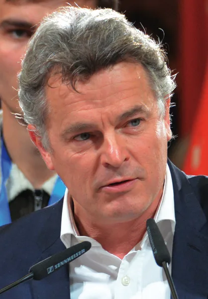

# Fabien Roussel

**PCF** · 58 ans au 1er tour (18 avril 2027)

Photo [Roussel Fabien 1.jpg](https://commons.wikimedia.org/wiki/File:Roussel_Fabien_1.jpg) · Zouhair NAKARA · [CC BY-SA 4.0](https://creativecommons.org/licenses/by-sa/4.0) · redimensionnée.

## Dans la course

- **Statut** : Candidat du PCF
- **Présidentielles passées** : 2022 : 2,28 %

## Aujourd’hui

Secrétaire national du PCF depuis 2018, maire de Saint-Amand-les-Eaux depuis 2025

## Parcours

- **2025** · Maire de Saint-Amand-les-Eaux *(élu)*
- **2018** · Secrétaire national du PCF *(parti)*
- **2017–2024** · Député du Nord *(élu)*
- **2014** · Conseiller municipal de Saint-Amand-les-Eaux *(élu)*

## Formation et métier

- **Formation** : Formation de reporter d’images au CFPJ
- **Métier** : Journaliste reporter d’images (L’Humanité, télévision)

## Sources

- [Wikipédia](https://fr.wikipedia.org/wiki/Fabien_Roussel)
- [LCP, 23 nov. 2026](https://lcp.fr/actualites/presidentielle-2027-la-liste-des-candidats-declares-et-potentiels-444932)

*À jour le 24 novembre 2026. Le repère sondages suit `js/data.js`.*
