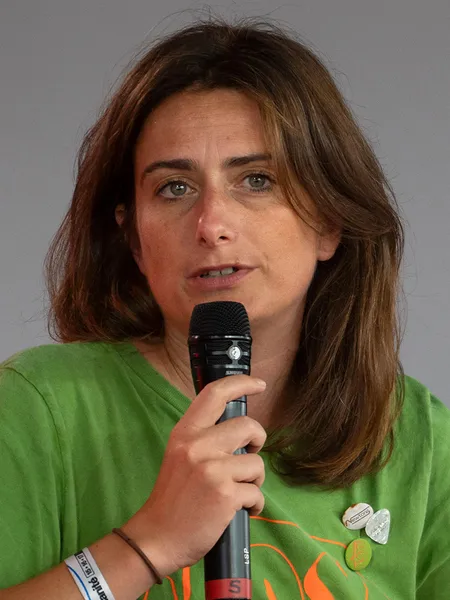

# Marine Tondelier

**Les Écologistes** · 40 ans au 1er tour (18 avril 2027)

Photo [Huma2023MarineTondelier (cropped).jpg](https://commons.wikimedia.org/wiki/File:Huma2023MarineTondelier_(cropped).jpg) · Selbymay · [CC BY 4.0](https://creativecommons.org/licenses/by/4.0) · redimensionnée.

## Dans la course

- **Statut** : Vote des militants des Écologistes le 13 décembre
- **Présidentielles passées** : aucune

## Aujourd’hui

Secrétaire nationale des Écologistes depuis 2022

## Parcours

- **2022** · Secrétaire nationale d’EELV, devenu Les Écologistes *(parti)*
- **2021** · Conseillère régionale des Hauts-de-France *(élue)*
- **2014** · Conseillère municipale d’Hénin-Beaumont *(élue)*

## Formation et métier

- **Formation** : Sciences Po Lille (2009), master en management des établissements de santé
- **Métier** : Déléguée générale d’Atmo France, réseau de surveillance de l’air (2017-2022)

## Sources

- [Wikipédia](https://fr.wikipedia.org/wiki/Marine_Tondelier)
- [LCP, 23 nov. 2026](https://lcp.fr/actualites/presidentielle-2027-la-liste-des-candidats-declares-et-potentiels-444932)

*À jour le 24 novembre 2026. Le repère sondages suit `js/data.js`.*
