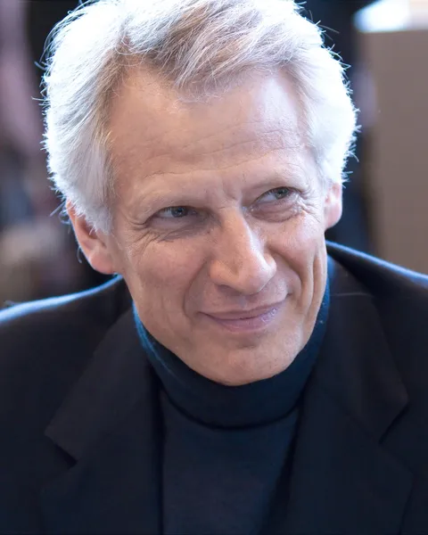

# Dominique de Villepin

**La France humaniste** · 73 ans au 1er tour (18 avril 2027)

Photo [Dominique de Villepin 20100330 Salon du livre de Paris 2 cropped.jpg](https://commons.wikimedia.org/wiki/File:Dominique_de_Villepin_20100330_Salon_du_livre_de_Paris_2_cropped.jpg) · Georges Seguin (Okki) · [CC BY-SA 3.0](https://creativecommons.org/licenses/by-sa/3.0) · redimensionnée.

## Dans la course

- **Statut** : Candidature officialisée le 20 novembre 2026
- **Présidentielles passées** : aucune

## Aujourd’hui

Fondateur de La France humaniste (juin 2025), avocat

## Parcours

- **2005–2007** · Premier ministre *(nommé)*
- **2004–2005** · Ministre de l’Intérieur *(nommé)*
- **2002–2004** · Ministre des Affaires étrangères *(nommé)*
- **1995–2002** · Secrétaire général de l’Élysée *(nommé)*

## Formation et métier

- **Formation** : ENA (promotion Voltaire, 1980), Sciences Po
- **Métier** : Diplomate, puis avocat

## Sources

- [Wikipédia](https://fr.wikipedia.org/wiki/Dominique_de_Villepin)
- [LCP, 23 nov. 2026](https://lcp.fr/actualites/presidentielle-2027-la-liste-des-candidats-declares-et-potentiels-444932)

*À jour le 24 novembre 2026. Le repère sondages suit `js/data.js`.*
